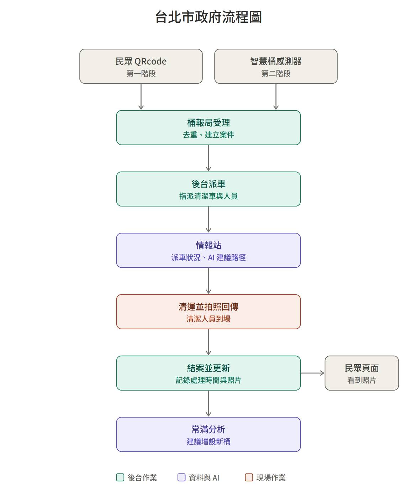

# 市府處理流程與實作對照

> 流程圖：Kyra（10/23）。第一階段用民眾掃 QR Code 回報，第二階段加上智慧垃圾桶感測器，兩個來源都進到同一條處理流程。

| 流程 | 誰做 | 我們的實作 | 在哪裡看 |
| --- | --- | --- | --- |
| 民眾 QR Code 回報（第一階段） | 市民 | 掃垃圾桶上的 QR Code，免註冊、免 App，按「這桶滿了」 | 市民端 `/#/bin/:id` |
| 智慧桶感測器（第二階段） | 硬體 | 尚未接入；目前以模擬填滿率代表感測器資料，`/api/fill-levels` 就是之後感測器的接口 | — |
| 桶報局受理：去重、建立案件 | 後台 | 同一桶、同一狀態、同一趟處理中的回報合併成一個案件，顯示「N 人回報」，標示待派車／清運中／已清運。市民掃到 30 分鐘內已有人回報的桶，會看到「處理中」 | 戰情室右側「市民回報」、市民端 |
| 後台派車：指派清潔車與人員 | 後台 | 依行政區派車，1–3 台車分工，記錄出發時間 | 戰情室「清運調度」 |
| 情報站：派車狀況、AI 建議路徑 | 資料與 AI | 只收超過門檻的桶，最近鄰居＋2-opt 排路線，多台車依方向分區；出勤中的車在地圖上行駛 | 戰情室地圖、3D 戰情室 |
| 清運並拍照回傳 | 現場 | 返隊後「拍照回傳」，手機直接開相機，照片壓縮後存進派車紀錄 | 戰情室「今日派車紀錄」 |
| 結案並更新：記錄處理時間與照片 | 後台 | 返隊時間＝結案時間；計算實際用時對預估、平均每桶分鐘 | 戰情室「今日派車紀錄」 |
| 民眾頁面：看到照片 | 市民 | 「你的回報進度」五步驟走到清運完成，顯示市府花了幾分鐘與清運照片 | 市民端 |
| 社群傳播：我為台北做了一件小事 | 市民 | 回報進度卡下方「分享」按鈕，手機叫出系統分享，電腦複製分享文字 | 市民端 |
| 公開處理成績單 | 所有人 | 各區 7 天回報、處理中、已清運、平均處理時間，平均 60 分鐘內有時效勳章；最近完成的案件附照片 | `/#/status` |
| 常滿分析：建議增設新桶 | 資料與 AI | 常滿而且 150 公尺內沒有其他桶的垃圾桶，列為建議增設（示範參數） | 戰情室「缺口熱區」 |

## 還沒做、之後可以做

- 感測器接入：`fill-levels` 改由感測器回報，QR Code 繼續保留處理突發狀況。
- AI 路線：目前是啟發式演算法（最近鄰居＋2-opt），之後可換成 OR-Tools 的車輛路徑問題（VRP），並接垃圾車 GPS。
- 常滿分析：目前沒有歷史資料，以即時填滿率與 7 天內回報代替；正式版用「7 天內 5 天滿載」判斷。
